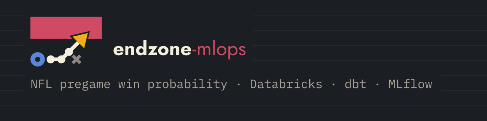

<p align="center">
  
</p>

# endzone-mlops

[](https://github.com/carloshgalvan95/endzone-mlops/actions/workflows/ci.yml)

NFL pregame prediction lakehouse demonstrating Databricks + dbt + MLflow + CI/CD patterns for MLOps portfolios.

## Problem Statement

Build a reproducible lakehouse pipeline for NFL pregame predictions (win probability, margin, total points) that demonstrates modern MLOps practices. Target audience: hiring managers evaluating Data Engineering, ML Engineering, or MLOps capabilities.

**This is a batch-first analytics platform**, not a sports betting application. The domain is NFL because the data story is rich and can become a real product later, but the primary goal is demonstrating: Databricks lakehouse architecture, dbt transformations, MLflow experiment tracking, GitHub Actions CI/CD, and modular Python design patterns.

## Current Status

**As of October 2026 (Day 7 done)**:

- **Databricks Free Edition**: Spike completed and passed. Serverless SQL warehouse validated with dbt-databricks locally and from GitHub Actions. MLflow tracking connectivity confirmed.
- **Bronze ingest**: Backfill complete (1999-2026, games and play-by-play). Unity Catalog tables: `workspace.nfl_raw.games`, `workspace.nfl_raw.play_by_play` (partitioned by season).
- **dbt**: 2 staging views (stg_nflverse__games, stg_nflverse__pbp), 3 marts tables (fct_games, fct_team_game_epa, fct_upcoming_games), 2 sources, 2 seeds. dbt build on Databricks: 64/64 nodes passing (57 data tests).
- **Training pipeline**: `src/train/train.py` with MLflow tracking. Supports a home baseline (constant probability equal to the training home win rate, hard home label when that rate is above one half), logistic regression (impute then standard-scale), and gradient boosting models. The default feature set is rolling EPA, win rate, rest days, and season offensive EPA (10-game lookback). `--feature-set diff` adds home-minus-away versions of those columns. `--feature-set diff_only` keeps only the differences. `--feature-set h2_def` adds season-to-date defensive EPA allowed. `--feature-set h2_full` also adds regressed season and recent EPA. `--feature-set h3_split` adds pass and rush EPA. `--feature-set h3_replace` swaps the combined recent and regressed-season EPA for those splits. `--model logistic_l2` is L2 logistic regression whose C is tuned inside the training seasons and does not use the scored season to pick C. `home_games_played` and `away_games_played` are still computed and available as `--feature-set with_games_played`. Time-based split (train through 2023, validate 2024, test 2025). Logs params, metrics (log loss, Brier, accuracy, AUC), feature list, data window, git SHA. Can run against Databricks or local fixtures. Includes SimpleImputer for missing history (EPA imputed to 0, win_rate to 0.5). Tests include leakage protection and January playoff season handling. Local tracking uses `sqlite:///mlflow.db` in the repo root, with run artifacts under `mlartifacts/`.
- **CI**: GitHub Actions runs ruff lint + format check, pytest on Python 3.10/3.11, dbt compile against DuckDB, cross-platform matrix (Ubuntu, Windows, macOS). Tests verify column references against real nflverse schema (fixtures in tests/fixtures), schema conforming logic, feature leakage protection, and end-to-end training.
- **PR Guard**: Branch protection with freshness check, Conventional Commit titles, PR template verification, no secrets/data files, commit identity validation.

**Next**: Feature and model experimentation. Forecasting (batch scoring) comes after that.

**2024 validation** (`make train-sweep`, 285 games, feature set that included `games_played`). Rounded to 2 decimals. The 2025 test season is held out and is not reported. Phase 1 does not replace this table. `make train-cv` writes the Phase 2 ridge reference comparison under `reports/phase2_ridge/`. The Phase 1 report stays `python -m src.train.train --cv`, which writes `reports/phase1/`. Hypothesis H1 writes `reports/phase2/`. Hypothesis H2 writes `reports/phase2_h2/`. Hypothesis H3 writes `reports/phase2_h3/`.

| Model | Accuracy | AUC | Brier | Log loss |
| --- | --- | --- | --- | --- |
| Home baseline (training prior) | 0.55 | 0.50 | 0.25 | 0.69 |
| Logistic regression (best of C=0.1, C=10) | 0.67 | 0.73 | 0.21 | 0.61 |
| Gradient boosting depth 3, 50 trees | 0.68 | 0.70 | 0.22 | 0.63 |
| Gradient boosting depth 5, 100 trees | 0.52 | 0.54 | 0.27 | 0.75 |

## Architecture Overview

**Target architecture** (components marked [done] or [planned]):

```
nflverse (historical)     BALLDONTLIE (future live, documented only)
    |                            |
    v                            v
HistoricalFeed [done]       LiveFeed (stub) [planned]
    |                            |
    +----------------------------+
                |
                v
         Bronze (raw data) [done]
                |
                v
    dbt: Staging [done] -> Marts [done]
                |
                v
       Feature Engineering (Python) [done]
                |
                v
    MLflow Tracking (train.py with hyperparameters) [done]
                |
                v
       Model Registry + Artifacts [planned]
                |
                v
         Batch Scoring (score.py) [planned]
                |
                v
      Predictions Table + Monitoring [planned]
```

### Key Design Decisions

- **Batch-first**: v0.1 focuses on offline training and batch scoring. Real-time inference is documented as a future adapter pattern, not implemented.
- **Historical source**: nflverse (CC BY 4.0, play-by-play from 1999+, Parquet format)
- **Live path (documented, not active)**: HistoricalFeed vs LiveFeed interface. LiveFeed target is BALLDONTLIE GOAT API (~$40/month) for post-v0.1 with owner approval. No API keys in repo, no live calls in v0.1.
- **Primary stack**: Databricks Free Edition + dbt-databricks + MLflow + GitHub Actions
- **Plan B**: Snowflake trial (same repo layout) if Databricks Free Edition spike fails

## Databricks schema map

Catalog: `workspace`.

| Schema | What lands there |
| --- | --- |
| `nfl_raw` | Bronze. `games` and `play_by_play`. Not built by dbt. |
| `nfl_dev` | dbt target schema (`dbt/profiles.yml.example`). Seeds have no custom schema, so `team_franchise_map` and `known_pbp_gaps` stay here. |
| `nfl_dev_staging` | Staging views `stg_nflverse__games` and `stg_nflverse__pbp`. |
| `nfl_dev_marts` | Marts `fct_games`, `fct_team_game_epa`, `fct_upcoming_games`. Training reads these. |
| `nfl_dev_test_results` | Stored dbt test failures (`+store_failures`, `+schema: test_results`). |

`dbt_project.yml` sets `+schema: staging`, `+schema: marts`, and `+schema: test_results`. This repo has no `generate_schema_name` macro, so dbt's default macro appends the custom schema to the target: `{target}_{custom}`. The target is `nfl_dev`, which is why the built schemas end in `_staging`, `_marts`, and `_test_results`. Do not query staging or marts from unsuffixed `nfl_dev`.

Env overrides for the Python client: `DATABRICKS_CATALOG` (default `workspace`), `DATABRICKS_STAGING_SCHEMA` (default `nfl_dev_staging`), `DATABRICKS_RAW_SCHEMA` (default `nfl_raw`), `DATABRICKS_MARTS_SCHEMA` (default `nfl_dev_marts`).

## Product Framing: NFLow (Optional Nickname)

The optional product name "NFLow" may appear in documentation. Repository name remains `endzone-mlops`.

### Two ML Products (Separate Experiments)

1. **Pregame**: Predict win probability, margin, total before kickoff
2. **In-game** (future): Update probability after each play

Experiments are tracked separately in MLflow. Never mix game states between train and test splits.

## Data Sources and Attribution

### Historical Data: nflverse

- **License**: CC BY 4.0
- **Coverage**: NFL play-by-play data from 1999-present
- **Format**: Parquet files (~370 columns, ~19.5 MB per season)
- **Updates**: Clean nightly; raw available ~15 minutes after game ends
- **Citation**: nflverse project (https://github.com/nflverse)

### Future Live Data: BALLDONTLIE (Documented Only)

- **Status**: Stub interface in v0.1; no active API calls
- **Target plan**: BALLDONTLIE NFL GOAT tier (~$39.99/month) for v0.2+
- **Capabilities**: Play-by-play, stats, injuries, odds (near-real-time, no published SLA)
- **Decision gate**: Activation requires explicit owner approval and is post-Day 14

**No vendor API keys, no live API calls, no paid subscriptions in v0.1.**

## Repository Structure

```
endzone-mlops/
├── README.md                   # This file
├── LICENSE                     # MIT
├── requirements.txt            # Python dependencies
├── pyproject.toml              # Package metadata
├── Makefile                    # Common tasks (lint, test, reproduce)
├── .env.example                # Environment template (no secrets)
├── .github/
│   └── workflows/
│       └── ci.yml             # Lint, pytest, dbt compile
├── infra/
│   └── README.md              # Databricks setup instructions
├── dbt/
│   ├── dbt_project.yml
│   ├── profiles.yml.example
│   ├── models/
│   │   ├── staging/           # stg_* models from raw nflverse
│   │   └── marts/             # Business logic transformations
│   ├── tests/
│   └── macros/
├── src/
│   ├── data/                  # Data ingestion, HistoricalFeed/LiveFeed
│   ├── features/              # Feature engineering
│   ├── models/                # train.py, score.py
│   └── utils/                 # Shared utilities
├── tests/                     # Pytest unit tests
├── notebooks/                 # Exploration only (not the product)
└── docs/
    ├── architecture.md        # C4 diagrams, detailed architecture
    ├── adr/                   # Architecture Decision Records
    │   └── ADR-001-databricks.md
    ├── runbook.md            # Operational procedures, CE spike status
    └── ATTRIBUTION.md        # Full data source credits
```

## How to Run

### Prerequisites

- Python 3.10+
- (Optional) Databricks Free Edition account
- (Optional) dbt installed locally or via Databricks SQL Warehouse

### Local Setup (Day 1 Path)

Cloud dev environment config (`.cursor/environment.json`) creates `.venv` and installs `requirements.txt`, with ruff pinned to 0.17.0 so it matches CI.

#### macOS / Linux

```bash
# Clone repository
git clone https://github.com/carloshgalvan95/endzone-mlops.git
cd endzone-mlops

# Create and activate virtual environment
python3 -m venv .venv
source .venv/bin/activate

# Install dependencies (or use: make setup)
pip install -r requirements.txt

# Copy config templates
cp .env.example .env
cp dbt/profiles.yml.example dbt/profiles.yml
# Edit .env and dbt/profiles.yml with your settings

# Run tests
make test

# Lint and format
make lint

# dbt: install packages and compile models (loads .env automatically)
make dbt-compile
```

**Tip**: Use `make setup` to automate virtualenv creation and dependency installation.

#### Windows (PowerShell)

```powershell
# Clone repository
git clone https://github.com/carloshgalvan95/endzone-mlops.git
cd endzone-mlops

# Create and activate virtual environment
python -m venv .venv
.venv\Scripts\Activate.ps1

# If activation is blocked, enable scripts (one-time):
# Set-ExecutionPolicy -Scope CurrentUser RemoteSigned

# Install dependencies (or use: .\scripts\dev.ps1 setup)
pip install -r requirements.txt

# Copy config templates
Copy-Item .env.example .env
Copy-Item dbt\profiles.yml.example dbt\profiles.yml
# Edit .env and dbt\profiles.yml with your settings

# Run tests
.\scripts\dev.ps1 test

# Lint and format
.\scripts\dev.ps1 lint

# dbt: install packages and compile models (loads .env automatically)
.\scripts\dev.ps1 dbt-compile
```

**Tip**: Use `.\scripts\dev.ps1 setup` to automate virtualenv creation and dependency installation.

### Training Models

After setting up the environment and building dbt models, you can train prediction models. Local runs record experiments in `sqlite:///mlflow.db` (repo root) and write model artifacts under `mlartifacts/`. Both paths are gitignored. If an existing `.env` still has `MLFLOW_TRACKING_URI=./mlruns` (or `mlruns`), change it to `MLFLOW_TRACKING_URI=sqlite:///mlflow.db`. MLflow 3.16 refuses the file store. Training logs a warning and uses `sqlite:///mlflow.db` when the value is a plain local path.

#### macOS / Linux

```bash
# Train with default settings (logistic regression, lookback=10)
make train

# Or specify model and hyperparameters
python -m src.train.train --model logistic --lookback 10 --C 1.0 --seed 42
python -m src.train.train --model gbm --n-estimators 100 --max-depth 5 --learning-rate 0.1
python -m src.train.train --model baseline-home

# Run training sweep (5+ configs for MLflow comparison)
make train-sweep

# View MLflow UI to compare runs
make mlflow-ui
# or: mlflow ui --backend-store-uri sqlite:///mlflow.db --workers 1
# Open http://localhost:5000 in browser
```

#### Windows (PowerShell)

```powershell
# Train with default settings
.\scripts\dev.ps1 train

# Or specify model and hyperparameters
python -m src.train.train --model logistic --lookback 10 --C 1.0 --seed 42
python -m src.train.train --model gbm --n-estimators 100 --max-depth 5 --learning-rate 0.1
python -m src.train.train --model baseline-home

# Run training sweep (5+ configs for MLflow comparison)
.\scripts\dev.ps1 train-sweep

# View MLflow UI to compare runs
.\scripts\dev.ps1 mlflow-ui
# or: mlflow ui --backend-store-uri sqlite:///mlflow.db --workers 1
# Open http://localhost:5000 in browser
```

`--workers 1` avoids a Windows uvicorn error (WinError 10022) when the UI starts more than one worker.

#### Windows (Git Bash)

Git Bash rewrites arguments that look like Unix paths, including `DATABRICKS_HTTP_PATH` (`/sql/1.0/...`). `make` exports `MSYS_NO_PATHCONV=1` for every target, including `train` and `train-sweep`. The variable is harmless on macOS and Linux. Set it yourself when you call Python outside `make`, and before `mlflow ui` so `sqlite:///` is left intact.

```bash
export MSYS_NO_PATHCONV=1

# Train with default settings (logistic regression, lookback=10)
make train

# Or specify model and hyperparameters
python -m src.train.train --model logistic --lookback 10 --C 1.0 --seed 42
python -m src.train.train --model gbm --n-estimators 100 --max-depth 5 --learning-rate 0.1
python -m src.train.train --model baseline-home

# Run training sweep (5+ configs for MLflow comparison)
make train-sweep

# View MLflow UI to compare runs
make mlflow-ui
# or: mlflow ui --backend-store-uri sqlite:///mlflow.db --workers 1
# Open http://localhost:5000 in browser
```

**Note**: Training requires either Databricks credentials (in .env) or local fixture files. Metrics (accuracy, Brier score, log loss, ROC AUC) are logged to MLflow along with model artifacts. The Day 7 sweep on 2024 validation is in Current Status. The 2025 test season is held out.

### Feature input audit

`make audit-features` (Windows: `.\scripts\dev.ps1 audit-features`) profiles the current pregame inputs and does not change them. It writes `reports/phase0/feature_audit.md` and `reports/phase0/feature_audit.csv`, and logs both on an MLflow run tagged `phase=0-audit` under experiment `nfl_pregame/phase0_audit`. Those files are local outputs. Code-reading findings are in `docs/experiments/phase0_input_audit.md`. The command uses the same Databricks credentials as training, or `--fixture-path` for a local frame. Pass extra CLI flags with `make audit-features AUDIT_ARGS="--fixture-path path/to/fixtures"`. 2025 is included in the distribution tables and is not scored.

### EPA play filter check

`make check-epa-filter` (Windows: `.\scripts\dev.ps1 check-epa-filter`) counts `workspace.nfl_dev_staging.stg_nflverse__pbp` rows with `play = 1` by `play_type`, which is the filter `fct_team_game_epa` uses. It also counts `qb_kneel = 1` and `qb_spike = 1`. Those columns are not on the staging view, so the counts come from `workspace.nfl_raw.play_by_play` unless a future staging view adds them. The command uses the same Databricks client as training and writes `reports/epa_filter_check.md` (gitignored). It does not change dbt models.

### Phase 1 baselines

`python -m src.train.train --cv` (default `--phase 1`) runs rolling-origin cross-validation: for each season S from 2016 through 2023, models train on seasons strictly before S and score S. 2024 is not scored. 2025 is not scored. The command logs the home prior, logistic regression on feature set `current` (no `games_played`) and on `with_games_played`, a simple Elo rating, and a no-vig closing moneyline when `home_moneyline` and `away_moneyline` are on the games table. The paired comparison is log loss against the home prior. Runs go to MLflow experiment `nfl_pregame/phase1_baselines` with tag `phase=1`. The comparison is written to `reports/phase1/` (gitignored). The method and an empty decision log are in `docs/experiments/phase1_baselines.md`. This README does not add measured CV numbers.

### Phase 2 H1: differential features

`python -m src.train.train --cv --phase 2 --hypothesis h1 --reference-model logistic --reference-feature-set current --output-dir reports/phase2` uses the same 2016-2023 window and scores logistic regression on `current`, `diff`, and `diff_only`, plus the home prior, Elo, and the market. The paired comparison is log loss against logistic `current`. Pass `--reference-model` and `--reference-feature-set` to choose a different reference. Phase 1's default report is unchanged. Runs go to MLflow experiment `nfl_pregame/phase2_h1` with tags `phase=2` and `hypothesis=h1-diff`. The comparison is written to `reports/phase2/` (gitignored). A set is accepted only when pooled log loss improves by at least 0.003 and the 95% paired interval lies entirely below 0. The local result is recorded in `docs/experiments/phase2_h1_diff_features.md`: both `diff` and `diff_only` were rejected. This README does not repeat that table.

### Phase 2 H2: season defense and regression

`python -m src.train.train --cv --phase 2 --hypothesis h2 --reference-model logistic --reference-feature-set current --output-dir reports/phase2_h2` scores logistic regression on `current`, `h2_def`, and `h2_full`, plus the home prior, Elo, and the market. The paired comparison is the same bootstrap against logistic `current`, and the acceptance rule is the same 0.003 log loss gain with the 95% interval entirely below 0. Runs go to MLflow experiment `nfl_pregame/phase2_h2` with tags `phase=2` and `hypothesis=h2-season-def-regression`. The comparison is written to `reports/phase2_h2/` (gitignored). The local result is recorded in `docs/experiments/phase2_h2_season_def_regression.md`: `h2_def` was rejected and `h2_full` was accepted. The gain comes from the regressed priors. The upper bound of that interval is close to 0, so the acceptance still has to be confirmed on the 2024 final validation. This README does not repeat that table. Later Phase 2 hypotheses use `h2_full` as the reference. This H2 command stays paired to `current`.

### Phase 2 H3: pass and rush EPA

`python -m src.train.train --cv --phase 2 --hypothesis h3 --reference-model logistic --reference-feature-set h2_full --output-dir reports/phase2_h3` scores logistic regression on `h2_full`, `h3_split`, and `h3_replace`, plus the home prior, Elo, and the market. The paired comparison is the same bootstrap against logistic `h2_full`, and the acceptance rule is the same 0.003 log loss gain with the 95% interval entirely below 0. Runs go to MLflow experiment `nfl_pregame/phase2_h3` with tags `phase=2` and `hypothesis=h3-pass-rush-epa`. The comparison is written to `reports/phase2_h3/` (gitignored). The local result is recorded in `docs/experiments/phase2_h3_pass_rush_epa.md`: both `h3_split` and `h3_replace` were rejected against logistic `h2_full` (log loss 0.6377, n=2191). `h3_split` is 0.6393 (difference +0.0016, interval -0.0009 to 0.0039) and `h3_replace` is 0.6395 (difference +0.0018, interval -0.0008 to 0.0043). Both have lower AUC (0.6801 and 0.6796) and lower accuracy. Splitting pass and rush adds noise at about 270 games per season. Combined EPA already carries the signal. This README does not repeat that table.

### Phase 2 ridge reference

`make train-cv` (Windows: `.\scripts\dev.ps1 train-cv`) is `--phase 2 --hypothesis ridge`. It scores fixed-C logistic regression on `h2_full` (the reference), `logistic_l2` on `h2_full`, `h3_split`, and `h3_replace`, plus the home prior, Elo, and the market. `logistic_l2` is L2 logistic regression. C is chosen inside each training fold by an expanding season split. The scored season is not used to pick C. The chosen C is logged on the MLflow child run and in the fold table. The paired comparison and the 0.003 acceptance rule are the same, against logistic `h2_full`. Runs go to MLflow experiment `nfl_pregame/phase2_ridge` with tags `phase=2` and `hypothesis=ridge-reference`. The comparison is written to `reports/phase2_ridge/` (gitignored). This is setup work: if `logistic_l2` on `h2_full` is not worse (`log_loss_diff` <= 0), it becomes the reference for the next hypothesis, so a later rejection means the columns lacked signal. The method and an empty result section are in `docs/experiments/phase2_ridge_reference.md`. This README does not add measured ridge numbers.

The parent run name for this comparison is `phase2-ridge-<timestamp>`.

### Reading CV runs in the MLflow UI

Every `--cv` invocation, including phase 1 and each phase 2 hypothesis, logs one parent run and one nested child per scored model. The parent name is `phase1-<timestamp>`, `phase2-h1-<timestamp>`, `phase2-h2-<timestamp>`, `phase2-h3-<timestamp>`, or `phase2-ridge-<timestamp>`. Open the parent to read `comparison.md` and `comparison.csv`. Its tags include `phase`, `hypothesis` when the phase has one, `cv_scheme`, `git_commit`, `reference_model`, `reference_feature_set`, `best_feature_set`, and `data_digest`. The dataset input is named `nfl_pregame_cv`. Its source text says the rows are `fct_games` joined to pregame features for seasons through the CV end season. `data_n_rows` and `data_n_columns` are params on the parent and on each child. The same `data_digest` on the parent and every child means those runs compared the same matrix.

Each child logs `log_loss_diff`, `log_loss_diff_ci_low`, and `log_loss_diff_ci_high` against the reference, plus a `decision` tag:

- `accepted`: pooled log loss improves by at least 0.003 and `log_loss_diff_ci_high` is below 0
- `rejected`: the candidate was scored and that rule failed
- `inconclusive`: the paired interval is missing
- `reference`: the reference model and feature set
- `baseline`: the home prior, Elo, or the market, when that row is not the reference

In the MLflow UI, filter with `tags.decision = 'accepted'` (or `rejected`, `reference`, `baseline`, `inconclusive`). Select the children of one parent and use Compare. `best_feature_set` on the parent is the accepted logistic set with the lowest pooled log loss. If none was accepted, it is the reference feature set.

**Important .env notes**:
- `.env` is for environment variables (e.g., Databricks credentials), not the Python virtual environment
- Format: `KEY=value` with no spaces around `=`
- DATABRICKS_HOST should NOT include `https://` prefix
- Git Bash (MINGW) on Windows mangles paths starting with `/`, including `DATABRICKS_HTTP_PATH`. `make` already exports `MSYS_NO_PATHCONV=1`. Add the same export to `~/.bashrc` if you run commands outside `make`.
- Migrate `MLFLOW_TRACKING_URI=./mlruns` to `MLFLOW_TRACKING_URI=sqlite:///mlflow.db`. A leftover file-store path is rewritten to sqlite with a warning.
- Both `.venv/` and `dbt/profiles.yml` are gitignored

### Databricks Free Edition Path

**Spike completed**: Databricks Free Edition serverless SQL warehouse works with dbt-databricks. See `docs/runbook.md` for setup details and troubleshooting.

**To run ingest and dbt against Databricks**:

macOS / Linux (bash):
```bash
# Load environment variables from .env
set -a; source .env; set +a

# Ingest nflverse data to Unity Catalog
make ingest       # Load games + play-by-play

# Build dbt models on Databricks
make dbt-build-databricks
```

Windows Git Bash:
```bash
export MSYS_NO_PATHCONV=1  # Prevent path conversion issues
set -a; source .env; set +a
make ingest
make dbt-build-databricks
```

Windows PowerShell:
```powershell
# Load environment automatically via scripts
.\scripts\dev.ps1 ingest
.\scripts\dev.ps1 dbt-build-databricks
```

See `docs/runbook.md` for credential setup, Unity Catalog volume paths, and verification queries.

## CI/CD

### GitHub Actions Workflows

**CI** (`.github/workflows/ci.yml`): Runs on every push and pull request:
- **Lint**: ruff check + ruff format --check
- **Test**: pytest on Python 3.10 and 3.11 (Ubuntu)
- **dbt compile**: Validates SQL against DuckDB (no Databricks credentials in CI yet)
- **Cross-platform**: Lint + pytest on windows-latest and macos-latest (Python 3.11)
- Tests include verification that staging models reference real nflverse column names (fixtures in tests/fixtures)

**Databricks Smoke Test** (`.github/workflows/databricks-smoke.yml`): Manual workflow_dispatch, runs dbt debug and dbt compile against Databricks using GitHub secrets (DATABRICKS_HOST, DATABRICKS_HTTP_PATH, DATABRICKS_TOKEN).

**PR Guard** (`.github/workflows/pr-guard.yml`): Automated PR validation:
- Branch must be up to date with main
- Conventional Commit PR titles (feat, fix, docs, chore, ci, test, refactor, perf, build)
- PR template with verification checklist
- No secrets or data files committed
- Commit identity checks (author/committer email validation)

**Branch protection**: main requires pr-guard + CI jobs to pass, branch must be up to date, no force pushes.

**Planned**: A Databricks integration job in CI that runs ingest for one season and dbt build in a separate CI schema on PRs that touch ingest or dbt.

## Roadmap

### v0.1 (Day 14 Target)
- [x] Repository scaffold
- [x] Bronze ingest to Unity Catalog Delta tables (games, play_by_play, 1999-2026 backfill complete)
- [x] Staging dbt models from nflverse (2 views)
- [x] Marts dbt models (fct_games, fct_team_game_epa, fct_upcoming_games)
- [x] dbt build on Databricks: 64/64 nodes passing (57 data tests)
- [x] CI with GitHub Actions (lint, tests, cross-platform, PR guard)
- [x] MLflow experiment tracking (train.py with baseline, logistic, gradient boosting)
- [x] Pregame feature engineering (rolling EPA, win rates, rest days; games played stays available as a legacy set)
- [x] Training sweep (5+ configs, make train-sweep)
- [x] First training runs on real Databricks data (2024 validation metrics above)
- [ ] Databricks integration job in CI
- [ ] Batch scoring pipeline (score.py)
- [ ] Documentation and demo

### v0.2+ (Post-Day 14)
- [ ] Activate LiveFeed adapter with BALLDONTLIE (requires paid subscription and approval)
- [ ] In-game prediction experiment
- [ ] Monitoring and drift detection
- [ ] Databricks Jobs or GitHub Actions schedule

## Related Documentation

- [Architecture](docs/architecture.md): Detailed C4 diagrams and component descriptions
- [Phase 0 input audit](docs/experiments/phase0_input_audit.md): What the current features do, from the code
- [ADR-001](docs/adr/ADR-001-databricks.md): Why Databricks + dbt + MLflow
- [Runbook](docs/runbook.md): Operational procedures and spike status
- [Attribution](docs/ATTRIBUTION.md): Full data source credits and licenses

## License

MIT License - see [LICENSE](LICENSE) file.

## Project Context

This portfolio project was built as part of an MLOps learning path, synthesizing concepts from:
- SWEBOK software engineering practices
- Wilson's modularity patterns for ML
- Databricks lakehouse architecture
- dbt analytics engineering
- MLflow experiment tracking

Production analogues: AWS Glue + Athena + Redshift Spectrum, Prefect/Airflow orchestration, and similar cloud data platform patterns.

---

**Important**: This is a learning project with production-shaped patterns, not production software. Batch-first design. Live streaming adapter documented but not implemented in v0.1.
