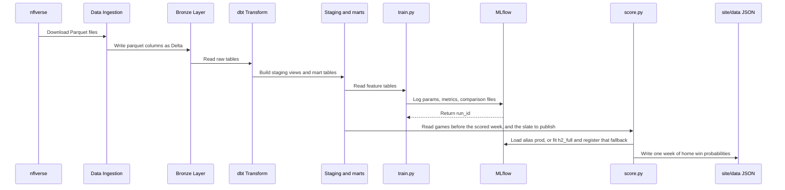

# Architecture Documentation

**Project**: endzone-mlops  
**Version**: 0.1.0  
**Last Updated**: 2026-11-10

## Overview

endzone-mlops demonstrates a lakehouse architecture for NFL analytics: Databricks Free Edition, dbt transformations, MLflow experiment tracking, and GitHub Actions. The Day 1 spike passed on 2026-10-06 (ADR-001). Snowflake was not activated.

**North Star**: Learning portfolio with production-shaped patterns. Batch-first analytics, not real-time streaming.

## C4 Model: Context (Level 1)

```
                                    NFL Fans / Data Scientists
                                              |
                                              | (views demos, explores data)
                                              v
                                    +-------------------+
                                    | endzone-mlops    |
                                    | NFL Lakehouse    |
                                    +-------------------+
                                              |
                          +-------------------+-------------------+
                          |                   |                   |
                          v                   v                   v
                 +-------------+     +---------------+    +--------------+
                 | nflverse    |     | Databricks    |    | GitHub       |
                 | (CC BY 4.0) |     | Free Edition  |    | Actions CI   |
                 +-------------+     +---------------+    +--------------+
                  Historical NFL           Compute              Automation
                  Play-by-Play           + Storage              + Testing
```

### External Systems

- **nflverse**: Public NFL data (play-by-play, games, players). CC BY 4.0 license. Historical only, not live.
- **Databricks Free Edition**: The lakehouse. Delta tables in Unity Catalog, the serverless SQL warehouse, serverless notebook compute, and MLflow. There is no custom cluster. Snowflake is not used.
- **GitHub Actions**: CI on push, pull request, a Monday schedule, and manual dispatch. Ubuntu runs ruff, the format check, the structure check, vulture, the full pytest suite, analysis coverage, and the local dbt compile. On a pull request, Windows and macOS run ruff, the format check, the structure check, and `pytest -m cross_platform`. Otherwise they run the full suite. `pages.yml` and `refresh-results.yml` deploy the weekly page.
- **BALLDONTLIE**: A live NFL API is not in the repo. It is not a dependency.

### Users

- **Carlos Galvan**: Portfolio owner, demonstrates MLOps capabilities
- **Hiring Managers**: Evaluate DE/MLE/MLOps skills via README and demo
- **Data Scientists**: Can fork and adapt for other sports/domains

## C4 Model: Containers (Level 2)

```
+-------------------------------------------------------------------------+
|                         endzone-mlops System                            |
|                                                                         |
|  +-----------------+     +-----------------+     +------------------+  |
|  | Data Ingestion  |     | dbt Transform   |     | ML Pipeline      |  |
|  | (Python)        |---->| (SQL + Jinja)   |---->| (Python+MLflow)  |  |
|  +-----------------+     +-----------------+     +------------------+  |
|        |                        |                        |              |
|        | writes                 | reads/writes           | logs         |
|        v                        v                        v              |
|  +------------------------------------------------------------------+  |
|  |                    Databricks Free Edition                      |  |
|  |  +-------------+  +-------------+  +-------------+  +---------+  |  |
|  |  | Bronze      |  | Staging     |  | Marts       |  | MLflow  |  |  |
|  |  | (raw data)  |->| (staging)   |->| (marts)     |  | Runs    |  |  |
|  |  +-------------+  +-------------+  +-------------+  +---------+  |  |
|  +------------------------------------------------------------------+  |
|                                                                         |
|  +------------------+           +--------------------+                  |
|  | GitHub Actions   |           | Notebooks          |                 |
|  | CI/CD            |           | (exploration only) |                 |
|  +------------------+           +--------------------+                  |
+-------------------------------------------------------------------------+
```

### Container Details

#### 1. Data Ingestion (`endzone/ingest/`) and mart reads (`endzone/data/`)

**Technology**: Python (pandas, pyarrow, Databricks SQL)

**Responsibility**:
- `endzone/ingest` downloads nflverse Parquet files and loads bronze tables
- `endzone/data` reads marts through the Databricks SQL client

**v0.1 Scope**: Scripted load of games, play-by-play, and depth charts.

**Future (v0.2+)**: A live adapter for the BALLDONTLIE API. That code is not in the repo.

#### 2. dbt Transform (`dbt/`)

**Technology**: dbt-core, SQL, Jinja templates

**Responsibility**:
- **Staging** (`models/staging/`): Clean, standardized views of bronze data
- **Marts** (`models/marts/`): Business logic aggregations for features and analysis
- **Tests**: Data quality checks (uniqueness, nulls, accepted values, business rules)
- **Documentation**: Column descriptions, lineage graphs

**Layers**:
- `stg_nflverse__games`: Game-level data (schedule, scores, lines)
- `stg_nflverse__pbp`: Play-by-play, including passer id, dropback, CPOE, and the pass and rush counts used by the QB box-score mart
- `stg_nflverse__depth_charts`: Depth charts from 2001. From 2025 the release is a timestamped snapshot, and ingest assigns each team-game the latest snapshot strictly before kickoff.
- `stg_nflverse__injuries`: Weekly injury reports from 2009. `date_modified` is null when the release has no clock. This view does not compare the timestamp to kickoff.
- `fct_games`: one row per completed game (both scores present)
- `fct_team_game_epa`: one row per team per completed game
- `fct_upcoming_games`: one row per game with both scores null
- `fct_expected_starter`: offense QB1 for each completed game. It does not read play-by-play.
- `fct_qb_dropbacks`: one row per completed game and passer. This is who played, not the starter.
- `fct_qb_box_scores`: one row per completed game and player, with pass and rush counting stats. The VALUE formula is applied in Python.

Seeds, in `nfl_dev` because they have no custom schema: `team_franchise_map`, `depth_chart_club_map`, `known_pbp_gaps`.

An in-game state table is not in the repo. Weekly predictions are JSON files, not a warehouse table (ADR-006).

#### 3. ML Pipeline (`endzone/modeling/`, `endzone/features/`)

**Technology**: Python, MLflow, scikit-learn/statsmodels

**Responsibility**:
- Feature engineering (rolling stats, team form, rest days)
- Model training (`python -m endzone.modeling.train`, argparse + seed + hyperparameters; `python -m endzone.train.train` is the same command)
- Experiment tracking (MLflow: params, metrics, artifacts, models)
- Batch scoring (`python -m endzone.modeling.score` fits logistic `h2_full` on games before the scored week, registers it, and writes one unpublished week of JSON. A published week file is kept unless `--replace-published` rebuilds the full scheduled week.)
- Margin and total (`python -m endzone.modeling.points`, ADR-007). Registered only when the pre-registered MAE rule passes
- Evaluation (metrics: log loss, Brier score, calibration, MAE, RMSE)

**v0.1 Scope**: Pregame win probability (logistic `h2_full`) plus margin and total. Both score targets passed ADR-007, so weekly scoring writes the estimate.

**Not in the repo**: an in-game model and a feature-distribution drift monitor. A mean ensemble is preregistered in `docs/experiments/ensembles.md` and is not registered. A defender-plus-Elo mean and stack are preregistered in `docs/experiments/ensembles_r2.md` and are not registered. A FiveThirtyEight QB adjustment on Elo is preregistered in `docs/experiments/qbelo538.md` and is not registered. A prior-strength and season-weight comparison is preregistered in `docs/experiments/prior_shrink.md` and is not registered. A margin-to-probability comparison is preregistered in `docs/experiments/margin.md` and is not registered. It does not change the ADR-007 score models. A group-logistic comparison is preregistered in `docs/experiments/groups.md` and is not registered. An injury-coverage and home-field comparison is preregistered in `docs/experiments/closing.md` and is not registered. The published log-loss alert is ADR-009.

#### 4. Delta storage (Databricks Free Edition)

**Technology**: Delta tables on Unity Catalog. `create_bronze_table` in `endzone/ingest/volume.py` runs `CREATE OR REPLACE TABLE ... USING DELTA AS SELECT ... FROM read_files(...)`. That statement replaces the existing bronze relation. Play-by-play and depth charts select `*`. Games selects `*` plus `ingested_at`, `cast(current_timestamp() as timestamp)`. The parquet upload still writes the downloaded frame with `index=False` and adds no column.

Catalog `workspace`. dbt's target schema is `nfl_dev`. This repo has no `generate_schema_name` macro, so dbt appends each custom schema: staging views land in `nfl_dev_staging` and marts land in `nfl_dev_marts`. Seeds stay in `nfl_dev`. `nfl_dev_test_results` exists only after one explicit `dbt test --store-failures`. `dbt build` does not create it, and `store_failures` stays off.

**Bronze** (`nfl_raw`), written by `python -m endzone.ingest.load_raw_nflverse`:

- `games`. `download_nflverse_games` keeps every column of the nflverse schedules parquet and filters rows by season. Staging reads `game_id`, `season`, `week`, `game_type`, `away_team`, `home_team`, `away_score`, `home_score`, `gameday`, `weekday`, `gametime`, `spread_line`, `total_line`, `away_moneyline`, `home_moneyline`, `location`, `roof`, `surface`, `temp`, `wind`, `away_rest`, `home_rest`, `gsis`, `pfr`, `pff`, `espn`, and `old_game_id`. Staging renames `gsis`, `pfr`, `pff`, and `espn` to `*_id`.
- `play_by_play`. Each season file is conformed to `endzone/ingest/schemas/pbp_schema.json` (372 columns) before upload. Those keys are the bronze columns. `wp` is one of them. Staging exposes it as `win_probability`.
- `depth_charts`. The uploaded parquet has only `DEPTH_CHART_COLUMNS` from `endzone/ingest/depth_charts.py`, in this order: `season`, `club_code`, `week`, `game_type`, `depth_team`, `last_name`, `first_name`, `football_name`, `formation`, `gsis_id`, `jersey_number`, `position`, `elias_id`, `depth_position`, `full_name`. From 2025 the release uses `dt` (a UTC scrape time) instead of `week`. Ingest uses `dt` to pick the latest scrape strictly before kickoff, then writes `week` and `game_type`. The bronze table does not include `dt`.
- `injuries`. Weekly reports from 2009. The stable columns are `INJURY_COLUMNS` in `endzone/ingest/injuries.py`. `date_modified` is the report update time. The 2025 and 2026 releases omit it, and ingest stores that column null. The feature code drops a null clock and any row on or after kickoff. The bronze table keeps those rows.

Play-by-play, depth charts, and injury reports have no row-hash column and no ingestion timestamp. `date_modified` on injuries is the report update time from nflverse, not the load time. `endzone/ingest/schemas/pbp_schema.json` has neither name. `DEPTH_CHART_COLUMNS` has neither name. Games gets `ingested_at` only in the warehouse replace (`endzone/ingest/volume.py`). The parquet file from `endzone/ingest/nflverse.py` does not have that column. The live `workspace.nfl_raw.games` table gains it when the games reload runs. Staging does not select it, so the marts do not gain a column.

**Staging** views: `stg_nflverse__games`, `stg_nflverse__pbp`, `stg_nflverse__depth_charts`, `stg_nflverse__injuries`. Column lists are the `select` in each SQL file.

**Marts**:

| Table | Grain | Columns |
| --- | --- | --- |
| `fct_games` | one completed game | `game_id`, `season`, `week`, `game_type`, `away_team`, `home_team`, `away_score`, `home_score`, `away_team_franchise`, `home_team_franchise`, `home_won`, `home_margin`, `total_points`, `home_covered_spread`, `total_over`, `spread_line`, `total_line`, `away_moneyline`, `home_moneyline`, `gameday`, `weekday`, `gametime`, `location`, `roof`, `surface`, `temp`, `wind`, `away_rest`, `home_rest` |
| `fct_team_game_epa` | one team in one completed game | `game_id`, `season`, `week`, `game_type`, `team`, `opponent`, `is_home`, `team_score`, `opponent_score`, `spread_line`, `total_line`, `gameday`, `team_franchise`, `opponent_franchise`, `offensive_plays`, `pass_plays`, `rush_plays`, `offensive_epa`, `avg_offensive_epa`, `pass_epa`, `rush_epa`, `successful_plays`, `success_rate`, `defensive_epa_allowed`, `avg_defensive_epa_allowed`, `clean_offensive_plays`, `avg_clean_offensive_epa`, `clean_success_rate`, `clean_defensive_plays`, `avg_clean_defensive_epa_allowed`, `clean_defensive_success_rate` |
| `fct_upcoming_games` | one game with both scores null | `game_id`, `season`, `week`, `game_type`, `away_team`, `home_team`, `away_team_franchise`, `home_team_franchise`, `gameday`, `weekday`, `gametime`, `spread_line`, `total_line`, `away_moneyline`, `home_moneyline`, `location`, `roof`, `surface`, `temp`, `wind`, `away_rest`, `home_rest` |
| `fct_expected_starter` | one completed game | `game_id`, `season`, `week`, `game_type`, `gameday`, `home_team`, `away_team`, `home_team_franchise`, `away_team_franchise`, `home_starter_player_id`, `away_starter_player_id` |
| `fct_qb_dropbacks` | one passer in one completed game | `game_id`, `season`, `week`, `gameday`, `team`, `team_franchise`, `passer_player_id`, `dropbacks`, `dropback_epa`, `cpoe_sum`, `cpoe_dropbacks` |
| `fct_depth_chart_starters` | one depth-1 player and position in one team-week | `season`, `week`, `game_type`, `team`, `gsis_id`, `position` |
| `fct_injury_reports` | one player report row | `season`, `week`, `game_type`, `team`, `gsis_id`, `report_status`, `date_modified` |

Those column lists are the final `select` of each mart. `fct_games` and `fct_upcoming_games` list every column in `dbt/models/marts/schema.yml` with `data_type` and `contract.enforced: true`. The other marts document a subset and the tests. The YAML lists columns the SQL already selects.

A predictions table, a `dim_*` table, and an in-game state table are not in the repo.

#### 5. MLflow Tracking (Databricks/Local)

**Functionality**:
- **Experiments**: `nfl_pregame`, `nfl_pregame/phase0_audit`, `nfl_pregame/phase1_baselines`, `nfl_pregame/phase2_h1` through `phase2_h5b` and `phase2_ridge`, `nfl_pregame/sprint2_score`, `nfl_pregame/weekly`, and `nfl_pregame/registry`. Those are the sqlite names. A Databricks tracking URI stores a relative name under `/Shared/endzone-mlops` (`ENDZONE_MLFLOW_EXPERIMENT_ROOT`). There is no in-game experiment in the repo.
- **Runs**: CV logs one parent run and one nested child per scored model. The single split, Sprint 2, the registry command, and weekly scoring each open their own run.
- **Model registry**: `make register-model` writes logistic `h2_full` to Unity Catalog as `workspace.nfl_dev.endzone_winprob`. `make promote-model` sets alias `prod` when the tags match the reference row, when a same-recipe walk-forward refresh stays within its margin, or when a different recipe is strictly better on that backtest. A `through_season` past 2023 without a walk-forward report is refused. Sprint 2 registers `endzone-margin` and `endzone-total` only when that target passes ADR-007. Weekly scoring loads alias `prod`.
- **Artifacts**: A CV run logs `comparison.md`, `comparison.csv`, and out-of-fold prediction files. It does not log the sklearn model (`endzone/modeling/tracking.py`). The single-split command logs the sklearn model (`endzone/modeling/holdout.py`). The phase 0 audit logs a markdown note and a csv that includes `permutation_importance_mean` (`endzone/analysis/feature_audit.py`). Sprint 2 logs a json report and a markdown report (`endzone/modeling/points.py`). A confusion-matrix plot is not in the repo.

**Access**:
- Databricks: Built-in UI
- Local: `mlflow ui --backend-store-uri sqlite:///mlflow.db`

#### 6. GitHub Actions (`.github/workflows/`)

Workflows in the repo: `ci.yml`, `pages.yml`, `refresh-results.yml`, `model-registry.yml`, `pr-guard.yml`, `databricks-smoke.yml`.

**`ci.yml`**: push and pull request to `main`, a Monday 12:00 UTC schedule, and `workflow_dispatch`. Ubuntu checks out, installs uv and Python 3.12, runs `uv sync --frozen`, `ruff check`, `ruff format --check`, `scripts/check_structure.py`, `lint-imports`, `vulture endzone scripts --min-confidence 80`, the full pytest suite, analysis coverage at 100%, then `dbt deps`, `dbt seed`, and `dbt compile` on local DuckDB. Windows and macOS run ruff, the format check, the structure check, and pytest. On a pull request that pytest command is `-m cross_platform`. On push, the weekly schedule, and a manual dispatch it is the full suite. They do not compile dbt. The job is not skipped, so the check name still reports. The README badge is this workflow. Counts and timings are in `docs/testing.md`.

`dbt build` on Databricks is `make dbt-build-databricks`. It is not a CI step. A CI job that builds warehouse tables with test data is not in the repo.

**`pages.yml`**: deploys `site/` to GitHub Pages on push to `main`, on a manual dispatch, and on Tuesdays at 12:00 UTC. A push restores `published-slates` first, overlays finals, writes the derived track record, archives the week files it will deploy, and does not fit a model. A failed archive does not deploy. A corrupt archived week fails the track record step and does not deploy. An unreachable archive deploys with an explicit unavailable record and no invented rates. Tuesday, and a dispatch without `replace_published`, score the next unpublished week after that restore. `replace_published` rebuilds every scheduled game for the given season and week, training only on games before that week, then the same overlay runs. `backfill_archive` seeds the branch from the live site and does not score or deploy. See ADR-006 and ADR-008.

**`refresh-results.yml`**: overlays finals, writes the track record, runs the log-loss alert, archives, and deploys. It has no warehouse credentials.

**`model-registry.yml`**: manual register or promote. It is not on the Pages schedule.

**`databricks-smoke.yml`**: manual `dbt debug` and `dbt compile` against the Databricks target. It is not part of `ci.yml`.

**`pr-guard.yml`**: checks the pull request title, body, author, and branch prefix.

#### 7. Notebooks (`notebooks/`)

**Purpose**: Exploration and prototyping ONLY. Not part of production pipeline.

**Philosophy** (Wilson 9): Notebooks are for experimentation. Once patterns solidify, move to modular Python in `endzone/`. Name a notebook `N.N-initials-description.ipynb`.

Local CCDS directories sit beside the package: `data/{raw,interim,processed,external}/` (git tracks `.gitkeep` only), `models/` (gitignored artifacts; there is no `endzone/models` package), `references/`, and `reports/figures/`. dbt stays a top-level project. Training still writes `reports/phase0`, `reports/phase1`, `reports/phase2*`, and `reports/epa_filter_check.md`. See ADR-002.

## Data Flow (Sequence)



After that write, Pages and Results overlay finals and write `site/data/track_record.json` from the archived slates. That file is derived. The build does not edit the week files to produce it. See ADR-008.

## Component Design Patterns

### Live feed

A second vendor for in-play data is not in the repo. Bronze history comes from nflverse through `endzone/ingest`.

### Wilson Modularity (endzone/)

```
endzone/
├── config.py                 # .env, DATABRICKS_*, MLflow tracking and registry URIs
├── data/
│   └── warehouse.py          # SQL reads and Volume upload
├── ingest/
│   ├── load_raw_nflverse.py  # python -m entrypoint
│   ├── cli.py                # Argument parsing and load steps
│   ├── nflverse.py           # Games and play-by-play downloads
│   ├── schema.py             # Play-by-play Arrow schema
│   ├── depth_charts.py       # Weekly depth charts
│   ├── snapshots.py          # 2025+ snapshot mapping
│   └── volume.py             # Volume upload and bronze DDL
├── features/
│   └── pregame.py            # Pregame feature engineering
├── modeling/                 # CV, train, score, registry, margin and total
├── site/                     # Results overlay, archive, track record, model alert
├── train/
│   └── train.py              # Training script (argparse, MLflow)
├── analysis/                 # Input audits
└── utils/
    └── logging.py            # Logging setup
```

**Principles**:
- Small, testable functions
- Config injected via argparse or env vars
- No logic in notebooks
- Entrypoints (`train.py`, `score.py`) orchestrate, not implement

### Schema Contracts

**dbt** (`dbt/models/staging/schema.yml`, `dbt/models/staging/sources.yml`, `dbt/models/marts/schema.yml`):
- Column tests (`unique`, `not_null`, accepted values, relationships)
- Business rules (for example `away_team != home_team` on `fct_games`)
- Column descriptions

Python checks are pytest. A Pydantic model is not in the repo. `endzone/config.py` reads environment variables. It does not validate them with a schema library.

## Deployment View

### Day 1-14: Development

- **Compute**: Databricks Free Edition serverless OR local DuckDB
- **Storage**: Databricks workspace OR local files
- **CI**: GitHub Actions (free tier)
- **MLflow**: Databricks managed OR local `sqlite:///mlflow.db`

### Weekly batch (live)

- **Pages** (`.github/workflows/pages.yml`): Tuesday 12:00 UTC loads alias `prod` for the next unpublished week, or fits that week when the alias is missing, then overlays finals, archives `published-slates`, and deploys `site/`. A push to `main` restores that branch and does not fit a model.
- **Results** (`.github/workflows/refresh-results.yml`): overlays finals on the published slate, writes the track record, runs the log-loss alert, and deploys, without warehouse credentials. Tuesday 08:30 UTC is the early pass before the scoring deploy.
- **Registry** (`.github/workflows/model-registry.yml`): manual register or promote. It is not on the Pages schedule.
- **Archive**: the orphan branch `published-slates`. A published week is not rescored.

A daily refresh, a feature-distribution drift monitor, and a live feed are not part of this batch. The published log-loss alert is the quality signal (ADR-009).

### Out of scope

These are not in the repo:

- Kubernetes
- Streaming (Kafka, Kinesis)
- A real-time API
- A feature store
- A second cloud, including Snowflake as a live warehouse
- An in-game state table

## Quality Attributes (ASRs)

### Reproducibility

**Requirement**: Any developer can clone repo and reproduce models.

**Implementation**:
- Pinned dependencies (`pyproject.toml` and `uv.lock`, Python 3.12)
- Seeds in MLflow runs
- Data provenance documented
- `make reproduce` installs the lock, builds Databricks marts, and refits the reference. It does not download nflverse and it does not register a model. Load bronze with `make data` on an empty catalog.

### Modularity

**Requirement**: No logic in notebooks; all testable.

**Implementation**:
- Wilson patterns (see `.cursor/rules/QUALITY_GUIDELINES.md`)
- Pytest for pure functions
- dbt tests for SQL logic

### Honesty

**Requirement**: No fake production claims. Not betting advice.

**Implementation**:
- The README says this is a learning project with production-shaped patterns, batch only
- It does not name employers or a CV
- The reference table shows the market log loss is lower
- ADRs document the spike and the limits

### Batch-First

**Requirement**: No real-time inference in v0.1.

**Implementation**:
- `python -m endzone.modeling.score` writes one unpublished week of JSON under `site/data`. It refuses to drop a published `game_id`. `--replace-published` rebuilds the full scheduled week.
- Margin and total points stay null unless both targets pass ADR-007. Both passed, so the page shows them.
- `python -m endzone.site.results` overlays final nflverse scores on those files. It does not refit the model.
- `python -m endzone.site.track_record` writes the weekly record from the archived slates. It does not refit the model and it does not edit a week file.
- Live feed code is not in the repo. It stays future work in this file.

## Trade-offs

| Decision | Benefit | Cost |
|----------|---------|------|
| Databricks Free Edition | MLflow in the same workspace, Delta tables | Usage quotas, serverless only, warehouse auto-stop. Snowflake was not activated |
| dbt | Versioned SQL, tests, docs | A compile step, and a separate warehouse build |
| Batch JSON scoring | One reproducible week file | A real-time API is not in the repo |
| nflverse | CC BY 4.0, no vendor secret | Historical files. A live feed is not in the repo |
| DuckDB for local compile | `make dbt-compile` needs no warehouse | Warehouse builds use the Databricks target |

## Security and Secrets

- **Never commit**: API keys, tokens, passwords, `.env` files
- **Use**: `.env.example`, `profiles.yml.example`, GitHub Secrets
- **dbt profiles**: Local file, never committed
- **Databricks token**: Environment variable, GitHub Secret

## Observability (Lite)

**Day 14 Scope**:
- Logging: Python `logging` module with timestamps
- One quality signal: published log loss gap above the reference CV gap plus a margin, one GitHub issue (ADR-009)

**Not in the repo**:
- A feature-distribution drift monitor
- A data-quality dashboard beyond dbt tests
- An alert channel other than the one GitHub issue (no Slack, no email)

## References

- [ADR-001](adr/ADR-001-databricks.md): Stack decision
- [ADR-002](adr/ADR-002-ccds-layout.md): CCDS layout
- [ADR-003](adr/ADR-003-config-and-warehouse.md): Config and warehouse
- [ADR-004](adr/ADR-004-modeling-and-hypotheses.md): Modeling and hypotheses
- [ADR-005](adr/ADR-005-acceptance-rule.md): Acceptance rule
- [ADR-006](adr/ADR-006-weekly-predictions.md): Weekly page and `published-slates`
- [ADR-007](adr/ADR-007-score-regression.md): Margin and total
- [ADR-008](adr/ADR-008-weekly-track-record.md): Public track record
- [Runbook](runbook.md): Operational procedures
- [QUALITY_GUIDELINES.md](../.cursor/rules/QUALITY_GUIDELINES.md): Engineering standards
- dbt Best Practices: https://docs.getdbt.com/guides/best-practices
- MLflow Tracking: https://mlflow.org/docs/latest/tracking.html
- Databricks Lakehouse: https://databricks.com/product/delta-lake-on-databricks

---

**Diagrams**: ASCII art and Mermaid for portability. Can generate PNG with Mermaid CLI for presentations.

**Maintenance**: Update this document when ASRs change or architecture evolves.
