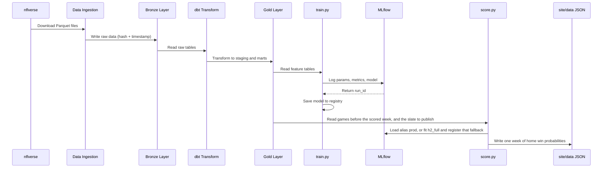

# Architecture Documentation

**Project**: endzone-mlops  
**Version**: 0.1.0  
**Last Updated**: 2026-11-09

## Overview

endzone-mlops demonstrates a modern lakehouse architecture for NFL analytics, combining Databricks (or Snowflake), dbt transformations, MLflow experiment tracking, and CI/CD automation.

**North Star**: Learning portfolio with production-shaped patterns. Batch-first analytics, not real-time streaming.

## C4 Model: Context (Level 1)

```
                                    NFL Fans / Data Scientists
                                              |
                                              | (views demos, explores data)
                                              v
                                    +-------------------+
                                    | endzone-mlops    |
                                    | NFL Lakehouse    |
                                    +-------------------+
                                              |
                          +-------------------+-------------------+
                          |                   |                   |
                          v                   v                   v
                 +-------------+     +---------------+    +--------------+
                 | nflverse    |     | Databricks    |    | GitHub       |
                 | (CC BY 4.0) |     | (or Snowflake)|    | Actions CI   |
                 +-------------+     +---------------+    +--------------+
                  Historical NFL           Compute              Automation
                  Play-by-Play           + Storage              + Testing
```

### External Systems

- **nflverse**: Public NFL data (play-by-play, games, players). CC BY 4.0 license. Historical only, not live.
- **Databricks Free Edition**: Primary lakehouse platform (or Snowflake trial as Plan B). Provides Delta Lake storage, serverless Spark compute, and MLflow tracking.
- **GitHub Actions**: CI on push and pull request. Ubuntu runs ruff, the structure check, vulture, pytest, analysis coverage, and the local dbt compile. Windows and macOS run ruff, the structure check, and pytest. `pages.yml` and `refresh-results.yml` deploy the weekly page.
- **BALLDONTLIE** (future): Live NFL API for v0.2+. Documented but not active in v0.1.

### Users

- **Carlos Galvan**: Portfolio owner, demonstrates MLOps capabilities
- **Hiring Managers**: Evaluate DE/MLE/MLOps skills via README and demo
- **Data Scientists**: Can fork and adapt for other sports/domains

## C4 Model: Containers (Level 2)

```
+-------------------------------------------------------------------------+
|                         endzone-mlops System                            |
|                                                                         |
|  +-----------------+     +-----------------+     +------------------+  |
|  | Data Ingestion  |     | dbt Transform   |     | ML Pipeline      |  |
|  | (Python)        |---->| (SQL + Jinja)   |---->| (Python+MLflow)  |  |
|  +-----------------+     +-----------------+     +------------------+  |
|        |                        |                        |              |
|        | writes                 | reads/writes           | logs         |
|        v                        v                        v              |
|  +------------------------------------------------------------------+  |
|  |                    Databricks / Snowflake                        |  |
|  |  +-------------+  +-------------+  +-------------+  +---------+  |  |
|  |  | Bronze      |  | Silver      |  | Gold        |  | MLflow  |  |  |
|  |  | (raw data)  |->| (staging)   |->| (marts)     |  | Runs    |  |  |
|  |  +-------------+  +-------------+  +-------------+  +---------+  |  |
|  +------------------------------------------------------------------+  |
|                                                                         |
|  +------------------+           +--------------------+                  |
|  | GitHub Actions   |           | Notebooks          |                 |
|  | CI/CD            |           | (exploration only) |                 |
|  +------------------+           +--------------------+                  |
+-------------------------------------------------------------------------+
```

### Container Details

#### 1. Data Ingestion (`endzone/ingest/`) and mart reads (`endzone/data/`)

**Technology**: Python (pandas, pyarrow, Databricks SQL)

**Responsibility**:
- `endzone/ingest` downloads nflverse Parquet files and loads bronze tables
- `endzone/data` reads marts through the Databricks SQL client

**v0.1 Scope**: Scripted load of games, play-by-play, and depth charts.

**Future (v0.2+)**: A live adapter for the BALLDONTLIE API. That code is not in the repo.

#### 2. dbt Transform (`dbt/`)

**Technology**: dbt-core, SQL, Jinja templates

**Responsibility**:
- **Staging** (`models/staging/`): Clean, standardized views of bronze data
- **Marts** (`models/marts/`): Business logic aggregations for features and analysis
- **Tests**: Data quality checks (uniqueness, nulls, accepted values, business rules)
- **Documentation**: Column descriptions, lineage graphs

**Layers**:
- `stg_nflverse__games`: Game-level data (schedule, scores, lines)
- `stg_nflverse__pbp`: Play-by-play, including passer id, dropback, and CPOE
- `stg_nflverse__depth_charts`: Depth charts from 2001. From 2025 the release is a timestamped snapshot, and ingest assigns each team-game the latest snapshot strictly before kickoff.
- `fct_games`, `fct_team_game_epa`, `fct_upcoming_games`: Schedule and team EPA marts
- `fct_expected_starter`: Offense QB1 for each completed game. It does not read play-by-play.
- `fct_qb_dropbacks`: Passer dropbacks and EPA by game. This is history, not the starter.
- `fct_ingame_states`: Play-level states for an in-game model (future)

#### 3. ML Pipeline (`endzone/modeling/`, `endzone/features/`)

**Technology**: Python, MLflow, scikit-learn/statsmodels

**Responsibility**:
- Feature engineering (rolling stats, team form, rest days)
- Model training (`python -m endzone.modeling.train`, argparse + seed + hyperparameters; `python -m endzone.train.train` is the same command)
- Experiment tracking (MLflow: params, metrics, artifacts, models)
- Batch scoring (`python -m endzone.modeling.score` fits logistic `h2_full` on games before the scored week, registers it, and writes one unpublished week of JSON. A published week file is kept unless `--replace-published` rebuilds the full scheduled week.)
- Margin and total (`python -m endzone.modeling.points`, ADR-007). Registered only when the pre-registered MAE rule passes
- Evaluation (metrics: log loss, Brier score, calibration, MAE, RMSE)

**v0.1 Scope**: Pregame win probability (logistic `h2_full`) plus margin and total. Both score targets passed ADR-007, so weekly scoring writes the estimate.

**Future**: In-game model, ensemble methods, and a feature-distribution drift monitor. None of those are in the repo. The published log-loss alert is ADR-009.

#### 4. Delta Lake / Storage (Databricks/Snowflake)

**Technology**: Delta Lake (Databricks) or Snowflake tables

**Schema Layers**:
- **Bronze** (`bronze_*`): Raw data, immutable, with hash and ingestion timestamp
- **Silver** (`stg_*`, `silver_*`): Cleaned, standardized, type-safe
- **Gold** (`fct_*`, `dim_*`, `mart_*`): Aggregated features, predictions

**Benefits**:
- ACID transactions
- Time travel (Delta Lake)
- Schema evolution
- Efficient Parquet/columnar storage

#### 5. MLflow Tracking (Databricks/Local)

**Functionality**:
- **Experiments**: `nfl_pregame`, `nfl_pregame/phase0_audit`, `nfl_pregame/phase1_baselines`, `nfl_pregame/phase2_h1` through `phase2_h5b` and `phase2_ridge`, `nfl_pregame/sprint2_score`, `nfl_pregame/weekly`, and `nfl_pregame/registry`. Those are the sqlite names. A Databricks tracking URI stores a relative name under `/Shared/endzone-mlops` (`ENDZONE_MLFLOW_EXPERIMENT_ROOT`). There is no in-game experiment in the repo.
- **Runs**: Each training iteration with params, metrics, artifacts
- **Model Registry**: Versioned models with lineage
- **Artifacts**: Plots, feature importance, confusion matrices

**Access**:
- Databricks: Built-in UI
- Local: `mlflow ui --backend-store-uri sqlite:///mlflow.db`

#### 6. GitHub Actions (`.github/workflows/ci.yml`)

**Triggers**: Push, pull request. `pages.yml` deploys `site/` to GitHub Pages on push to `main`, on a manual dispatch, and on Tuesdays at 12:00 UTC. A push restores `published-slates` first, overlays finals, writes the derived track record, archives the week files it will deploy, and does not fit a model. A failed archive does not deploy. A corrupt archived week fails the track record step and does not deploy. An unreachable archive deploys with an explicit unavailable record and no invented rates. Tuesday, and a dispatch without `replace_published`, score the next unpublished week after that restore. `replace_published` rebuilds every scheduled game for the given season and week, training only on games before that week, then the same overlay runs. `backfill_archive` seeds the branch from the live site and does not score or deploy. See ADR-006 and ADR-008.

**Steps**:
1. Checkout code
2. Install dependencies
3. Lint (ruff)
4. Structure (`scripts/check_structure.py` and `lint-imports`)
5. Test (pytest)
6. dbt compile (validate SQL)
7. (Future) dbt build with test data

**Badge**: Shows CI status in README.

#### 7. Notebooks (`notebooks/`)

**Purpose**: Exploration and prototyping ONLY. Not part of production pipeline.

**Philosophy** (Wilson 9): Notebooks are for experimentation. Once patterns solidify, move to modular Python in `endzone/`. Name a notebook `N.N-initials-description.ipynb`.

Local CCDS directories sit beside the package: `data/{raw,interim,processed,external}/` (git tracks `.gitkeep` only), `models/` (gitignored artifacts; there is no `endzone/models` package), `references/`, and `reports/figures/`. dbt stays a top-level project. Training still writes `reports/phase0`, `reports/phase1`, `reports/phase2*`, and `reports/epa_filter_check.md`. See ADR-002.

## Data Flow (Sequence)



After that write, Pages and Results overlay finals and write `site/data/track_record.json` from the archived slates. That file is derived. The build does not edit the week files to produce it. See ADR-008.

## Component Design Patterns

### Future live feed

A second vendor for in-play data is not in this repo. Bronze history comes from nflverse through `endzone/ingest`.

### Wilson Modularity (endzone/)

```
endzone/
├── config.py                 # .env, DATABRICKS_*, MLflow tracking and registry URIs
├── data/
│   └── warehouse.py          # SQL reads and Volume upload
├── ingest/
│   ├── load_raw_nflverse.py  # python -m entrypoint
│   ├── cli.py                # Argument parsing and load steps
│   ├── nflverse.py           # Games and play-by-play downloads
│   ├── schema.py             # Play-by-play Arrow schema
│   ├── depth_charts.py       # Weekly depth charts
│   ├── snapshots.py          # 2025+ snapshot mapping
│   └── volume.py             # Volume upload and bronze DDL
├── features/
│   └── pregame.py            # Pregame feature engineering
├── modeling/                 # CV, train, score, registry, margin and total
├── site/                     # Results overlay, archive, track record, model alert
├── train/
│   └── train.py              # Training script (argparse, MLflow)
├── analysis/                 # Input audits
└── utils/
    └── logging.py            # Logging setup
```

**Principles**:
- Small, testable functions
- Config injected via argparse or env vars
- No logic in notebooks
- Entrypoints (`train.py`, `score.py`) orchestrate, not implement

### Schema Contracts

**dbt** (`schema.yml`):
- Column-level tests (unique, not_null)
- Business rules (e.g., `away_team != home_team`)
- Documentation for downstream users

**Python** (Pydantic):
- Config validation
- Type safety for features and predictions
- Fail fast on schema mismatches

## Deployment View

### Day 1-14: Development

- **Compute**: Databricks Free Edition serverless OR local DuckDB
- **Storage**: Databricks workspace OR local files
- **CI**: GitHub Actions (free tier)
- **MLflow**: Databricks managed OR local `sqlite:///mlflow.db`

### Weekly batch (live)

- **Pages** (`.github/workflows/pages.yml`): Tuesday 12:00 UTC loads alias `prod` for the next unpublished week, or fits that week when the alias is missing, then overlays finals, archives `published-slates`, and deploys `site/`. A push to `main` restores that branch and does not fit a model.
- **Results** (`.github/workflows/refresh-results.yml`): overlays finals on the published slate, writes the track record, runs the log-loss alert, and deploys, without warehouse credentials. Tuesday 08:30 UTC is the early pass before the scoring deploy.
- **Registry** (`.github/workflows/model-registry.yml`): manual register or promote. It is not on the Pages schedule.
- **Archive**: the orphan branch `published-slates`. A published week is not rescored.

A daily refresh, a feature-distribution drift monitor, and a live feed are not part of this batch. The published log-loss alert is the quality signal (ADR-009).

### NOT in Scope (v0.1)

- Kubernetes
- Streaming (Kafka, Kinesis)
- Real-time API (FastAPI)
- Feature store (Databricks/Feast)
- Multi-cloud

## Quality Attributes (ASRs)

### Reproducibility

**Requirement**: Any developer can clone repo and reproduce models.

**Implementation**:
- Pinned dependencies (`pyproject.toml` and `uv.lock`, Python 3.12)
- Seeds in MLflow runs
- Data provenance documented
- `make reproduce` installs the lock, builds Databricks marts, and refits the reference. It does not download nflverse and it does not register a model. Load bronze with `make data` on an empty catalog.

### Modularity

**Requirement**: No logic in notebooks; all testable.

**Implementation**:
- Wilson patterns (see `.cursor/rules/QUALITY_GUIDELINES.md`)
- Pytest for pure functions
- dbt tests for SQL logic

### Honesty

**Requirement**: No fake production claims. Not betting advice.

**Implementation**:
- The README says this is a learning project with production-shaped patterns, batch only
- It does not name employers or a CV
- The reference table shows the market log loss is lower
- ADRs document the spike and the limits

### Batch-First

**Requirement**: No real-time inference in v0.1.

**Implementation**:
- `python -m endzone.modeling.score` writes one unpublished week of JSON under `site/data`. It refuses to drop a published `game_id`. `--replace-published` rebuilds the full scheduled week.
- Margin and total points stay null unless both targets pass ADR-007. Both passed, so the page shows them.
- `python -m endzone.site.results` overlays final nflverse scores on those files. It does not refit the model.
- `python -m endzone.site.track_record` writes the weekly record from the archived slates. It does not refit the model and it does not edit a week file.
- Live feed code is not in the repo. It stays future work in this file.

## Trade-offs

| Decision | Benefit | Cost |
|----------|---------|------|
| Databricks Free Edition over Snowflake | MLflow native, lakehouse narrative | Usage quotas (serverless-only, auto-stop) |
| dbt over Spark SQL scripts | Version control, testing, docs | Learning curve, compilation step |
| Batch scoring over API | Simpler for portfolio, reproducible | No demo of real-time inference |
| nflverse over live API | Free, CC BY 4.0, no secrets | Historical only; dual-vendor for live |
| DuckDB for local dev | Zero setup, fast | Not production-grade; switch for deployment |

## Security and Secrets

- **Never commit**: API keys, tokens, passwords, `.env` files
- **Use**: `.env.example`, `profiles.yml.example`, GitHub Secrets
- **dbt profiles**: Local file, never committed
- **Databricks token**: Environment variable, GitHub Secret

## Observability (Lite)

**Day 14 Scope**:
- Logging: Python `logging` module with timestamps
- One quality signal: published log loss gap above the reference CV gap plus a margin, one GitHub issue (ADR-009)

**Future**:
- Feature-distribution drift (PSI, KS test)
- Data quality dashboards (Great Expectations + dbt tests)
- Alerting beyond that one issue (Slack, email)

## References

- [ADR-001](adr/ADR-001-databricks.md): Stack decision
- [ADR-002](adr/ADR-002-ccds-layout.md): CCDS layout
- [ADR-003](adr/ADR-003-config-and-warehouse.md): Config and warehouse
- [ADR-004](adr/ADR-004-modeling-and-hypotheses.md): Modeling and hypotheses
- [ADR-005](adr/ADR-005-acceptance-rule.md): Acceptance rule
- [ADR-006](adr/ADR-006-weekly-predictions.md): Weekly page and `published-slates`
- [ADR-007](adr/ADR-007-score-regression.md): Margin and total
- [ADR-008](adr/ADR-008-weekly-track-record.md): Public track record
- [Runbook](runbook.md): Operational procedures
- [QUALITY_GUIDELINES.md](../.cursor/rules/QUALITY_GUIDELINES.md): Engineering standards
- dbt Best Practices: https://docs.getdbt.com/guides/best-practices
- MLflow Tracking: https://mlflow.org/docs/latest/tracking.html
- Databricks Lakehouse: https://databricks.com/product/delta-lake-on-databricks

---

**Diagrams**: ASCII art and Mermaid for portability. Can generate PNG with Mermaid CLI for presentations.

**Maintenance**: Update this document when ASRs change or architecture evolves.
